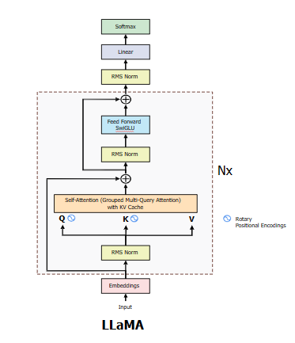
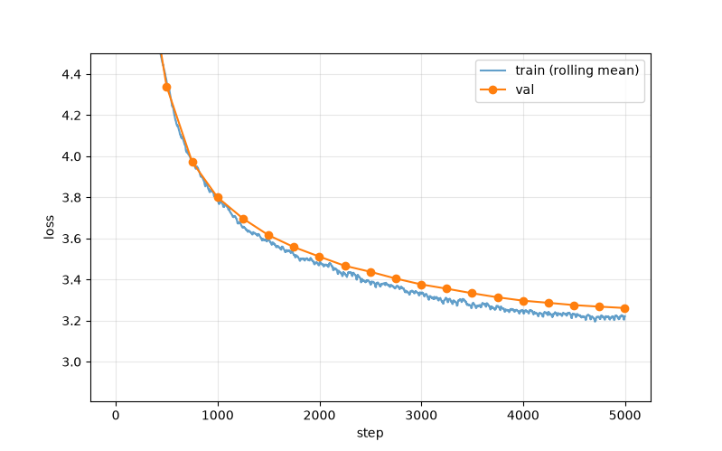

# LLaMA 3

A from-scratch Llama 3-style model as per <https://arxiv.org/abs/2407.21783>

## Changes from GPT2

### RoPE

This model has RoPE as apposed the absolute positional encodings:

- RoPE rotates q and k inside every attention layer by an angle proportional to position, so attnetion scores depend only on the relative offeset $m-n$
- No position parameters, no position information in the residual stream, and it generalises better beyond the trained length

### RMSNorm (replaces LayerNorm)

- LayerNorm subtracts the mean, divides by the standard deviation, then applies a learned scale and bias.
- RMSNorm skips the mean subtract and bias: $y =  \frac{x}{g \times \sqrt{\text{mean}(x^2) + \epsilon}} \times \gamma$
- Fewer operations and params, and in practice is just as stable.

### SwiGLU (replaces the GELU MLP)

- GPT-2: down(GELU(up(x))), with a hidden size of $4d$
- SwiGLU: down(SiLU(gate(x))) $\odot$ up(x), one branch acts as learned gate on other
- This uses three matrices instead of two, so the hidden size drops to about 8/3*d to keep the parameter count the same.

### Grouped Query Attention

- In multihead attention every query heads has its own key and value heads
- In GQA, groups of query heads shard one K/V head (e.g. 12 query heads, 4KV Heads)
- Next i will add a KV Cache to make this even more efficient and inline with the paper

## Architecture

Below see the architecture I have implemented (minus the KV cache):



## Results

I trained a 131.8M parameter model on FineWeb-Edu (99 train shards, 1 val shard) for 5,000 steps, or about 2.6B tokens, on 2 GPUs with DDP.

| Metric | Value |
| --- | --- |
| Final val loss | 3.2612 |
| Best val loss | 3.2612 |
| Median throughput | 876,074 tok/s |

Val loss was still falling when the run ended, so the best value is also the final one.



The y-axis is cut off at 4.5 to show the later steps; the loss starts at about 11.

### Config

```json
{
  "train": {
    "run_name": "fineweb-llama-132m",
    "runs_root": "/workspace/runs",
    "data_path": "/workspace/nanoGPT/edu_fineweb10B",
    "resume": false,
    "B": 32,
    "T": 1024,
    "total_batch": 524288,
    "max_lr": 0.0006,
    "min_lr_ratio": 0.1,
    "warmup_steps": 200,
    "max_steps": 5000,
    "weight_decay": 0.1,
    "grad_clip": 1.0,
    "eval_every": 250,
    "val_steps": 20,
    "gen_every": 100,
    "save_every": 500,
    "seed": 1337,
    "compile": true
  },
  "model": {
    "vocab_size": 50304,
    "block_size": 1024,
    "n_layer": 12,
    "n_embd": 768,
    "n_head": 12,
    "n_groups": 4,
    "theta": 10000.0,
    "eps": 1e-05,
    "sdpa": true
  }
}
```
